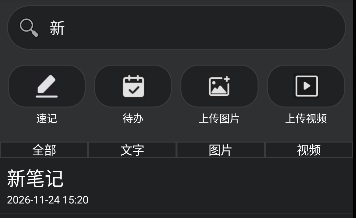
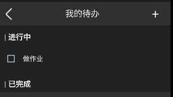
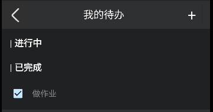
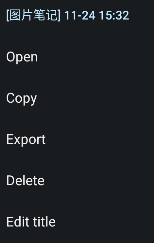
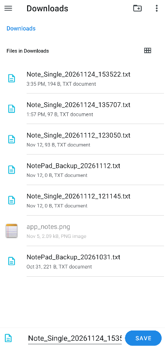
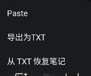
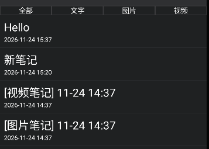
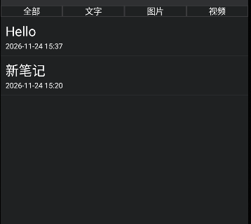
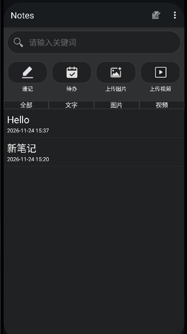
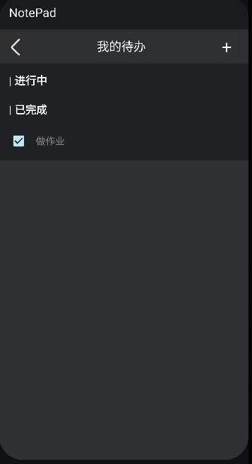

# NotePad 记事本应用

> 项目来自于官方早期的数据库操作的基本教程。更多的解析参考[Android Sample--NotePad解析](https://blog.csdn.net/llfjfz/article/details/67638499)

## 一、项目简介
本项目基于 Google 官方 NotePad 源码进行功能扩展，完成了移动软件开发期中实验的基本要求，并在此基础上扩展了待办事项、多媒体笔记（图片/视频）、导入导出等实用功能。

## 二、开发环境
- **开发工具**：Android Studio 2026.1.3
- **编程语言**：Java
- **目标 SDK**：API 34
- **测试设备**：Android 模拟器 - Pixel 8 (Android 14.0, API 34)

## 三、功能实现

###  基本要求
1. **笔记时间戳显示**：在 NoteList 界面中，每条笔记下方显示最后修改时间（格式：`yyyy-MM-dd HH:mm`），利用 `SimpleCursorAdapter.ViewBinder` 实现。


2. **笔记查询功能**：在列表顶部增加搜索框，通过 `TextWatcher` 监听输入，支持按**标题**或**内容**进行实时模糊查询。



###  附加功能
- **待办功能**：新增待办笔记列表，支持与普通笔记分类展示，标记完成状态。





- **图片笔记**：通过系统相册选择图片，列表显示缩略图，点击可调用系统查看器打开。


- **视频笔记**：通过文件选择器选择视频，列表显示播放图标，点击调用系统播放器播放。


- **笔记导出**：支持将全部笔记或单条笔记导出为 `.txt` 文件。





- **笔记导入/恢复**：支持从 `.txt` 文件批量导入笔记，自动解析并写入数据库。



- **分类**：按照不同类型笔记分类。





- **UI 美化**：自定义列表项布局，增加底部功能按钮（速记、待办、图片、视频），优化视觉层次。





## 四、项目结构
com.example.android.notepad
- NotePad.java # 数据契约类 
- NotePadProvider.java # ContentProvider，负责数据库增删改查
- NotesList.java # 主界面：笔记列表、搜索、导入导出、多媒体入口
- NoteEditor.java # 笔记编辑界面
- TitleEditor.java # 标题编辑界面
- TodoActivity.java # 待办笔记列表
- NotesLiveFolder.java # ContentProvider的LiveFolder（实时文件夹）


## 五、关键实现说明
### 1. 时间戳显示
在查询投影中加入 `COLUMN_NAME_MODIFICATION_DATE`，通过 `ViewBinder` 将 `long` 型时间戳格式化为可读字符串。

```agsl
adapter.setViewBinder(new SimpleCursorAdapter.ViewBinder() {
    @Override
    public boolean setViewValue(View view, Cursor cursor, int columnIndex) {
        if (view.getId() == R.id.text2) {
            long timeMillis = cursor.getLong(cursor.getColumnIndexOrThrow(NotePad.Notes.COLUMN_NAME_MODIFICATION_DATE));
            SimpleDateFormat sdf = new SimpleDateFormat("yyyy-MM-dd HH:mm", Locale.getDefault());
            ((TextView) view).setText(sdf.format(new Date(timeMillis)));
            return true;
        }
        // ... 此处省略多媒体缩略图判断代码
    }
});
```

### 2. 搜索功能
动态拼接 SQL `WHERE` 子句：`(title LIKE ? OR note LIKE ?) AND is_todo = 0`，重新查询并刷新列表。

```agsl
private void performSearch(String keyword){
        StringBuilder selectionBuilder = new StringBuilder();
        selectionBuilder.append(NotePad.Notes.COLUMN_NAME_IS_TODO).append(" = 0");

        // ... 此处省略类型过滤条件代码
        
        // 加入关键词搜索
        if (keyword != null && !keyword.trim().isEmpty()) {
            selectionBuilder.append(" AND (")
                    .append(NotePad.Notes.COLUMN_NAME_TITLE).append(" LIKE ? OR ")
                    .append(NotePad.Notes.COLUMN_NAME_NOTE).append(" LIKE ?)");
            String searchPattern = "%" + keyword.trim() + "%";
            argsList.add(searchPattern);
            argsList.add(searchPattern);
        }

        String[] selectionArgs = argsList.isEmpty() ? null : argsList.toArray(new String[0]);

        Cursor newCursor = getContentResolver().query(
                getIntent().getData(),
                PROJECTION,
                selectionBuilder.toString(),
                selectionArgs,
                NotePad.Notes.DEFAULT_SORT_ORDER
        );

        Cursor oldCursor = adapter.getCursor();
        adapter.changeCursor(newCursor);

        if(oldCursor != null && oldCursor != newCursor){
            oldCursor.close();
        }
    }
```

### 3. 多媒体笔记
将图片/视频的 `content://` URI 存入笔记的 `note` 字段，列表通过 MIME 类型（`image/*` 或 `video/*`）区分显示缩略图或播放图标，点击时调用系统组件打开。
```agsl
adapter.setViewBinder(new SimpleCursorAdapter.ViewBinder() {
    @Override
    public boolean setViewValue(View view, Cursor cursor, int columnIndex) {
        if (view.getId() == R.id.text2) {
            long timeMillis = cursor.getLong(cursor.getColumnIndexOrThrow(NotePad.Notes.COLUMN_NAME_MODIFICATION_DATE));
            SimpleDateFormat sdf = new SimpleDateFormat("yyyy-MM-dd HH:mm", Locale.getDefault());
            ((TextView) view).setText(sdf.format(new Date(timeMillis)));
            return true;
        }
        if (view.getId() == R.id.item_image) {
            String noteContent = cursor.getString(
                    cursor.getColumnIndexOrThrow(NotePad.Notes.COLUMN_NAME_NOTE));
            ImageView imageView = (ImageView) view;

            if (noteContent != null && noteContent.startsWith("content://")) {
                // 通过 MIME 类型判断是图片还是视频
                String mimeType = getContentResolver().getType(Uri.parse(noteContent));
                if (mimeType != null && mimeType.startsWith("video/")) {
                    // 是视频：显示一个占位图标
                    imageView.setVisibility(View.VISIBLE);
                    imageView.setImageResource(android.R.drawable.ic_media_play);
                } else {
                    // 是图片：显示缩略图
                    imageView.setVisibility(View.VISIBLE);
                    try {
                        imageView.setImageURI(Uri.parse(noteContent));
                    } catch (Exception e) {
                        imageView.setImageResource(android.R.drawable.ic_menu_gallery);
                    }
                }
            } else {
                imageView.setVisibility(View.GONE);
            }
            return true;
        }
        return false;
    }
});
```
选择图片时持久化 URI 权限并插入数据库：
```agsl
// 图片按钮：打开系统相册选择图片
Intent intent = new Intent(Intent.ACTION_OPEN_DOCUMENT);
intent.setType("image/*");
intent.addFlags(Intent.FLAG_GRANT_READ_URI_PERMISSION | Intent.FLAG_GRANT_PERSISTABLE_URI_PERMISSION);
startActivityForResult(intent, 1001);

// onActivityResult 中处理图片插入
if (requestCode == 1001) {
    try {
        getContentResolver().takePersistableUriPermission(
                fileUri,
                Intent.FLAG_GRANT_READ_URI_PERMISSION
        );
    } catch (SecurityException e) {
        e.printStackTrace();
    }

    ContentValues values = new ContentValues();
    values.put(NotePad.Notes.COLUMN_NAME_TITLE, "[图片笔记] " + new SimpleDateFormat("MM-dd HH:mm", Locale.getDefault()).format(new Date()));
    values.put(NotePad.Notes.COLUMN_NAME_NOTE, fileUri.toString());
    values.put(NotePad.Notes.COLUMN_NAME_MODIFICATION_DATE, System.currentTimeMillis());
    values.put(NotePad.Notes.COLUMN_NAME_IS_TODO, 0);
    values.put(NotePad.Notes.COLUMN_NAME_NOTE_TYPE, 1);

    getContentResolver().insert(getIntent().getData(), values);
    performSearch("");
    Toast.makeText(this, "图片笔记已保存", Toast.LENGTH_SHORT).show();
}
```
点击列表项时按 MIME 类型打开视频或图片：
```agsl
@Override
protected void onListItemClick(ListView l, View v, int position, long id) {
    Uri uri = ContentUris.withAppendedId(getIntent().getData(), id);
    Cursor cursor = (Cursor) getListAdapter().getItem(position);
    String noteContent = cursor.getString(
            cursor.getColumnIndexOrThrow(NotePad.Notes.COLUMN_NAME_NOTE));

    if (noteContent != null && noteContent.startsWith("content://")) {
        Uri contentUri = Uri.parse(noteContent);
        String mimeType = getContentResolver().getType(contentUri);

        if (mimeType != null && mimeType.startsWith("video/")) {
            // 播放视频
            Intent intent = new Intent(Intent.ACTION_VIEW);
            intent.addFlags(Intent.FLAG_GRANT_READ_URI_PERMISSION);
            intent.addFlags(Intent.FLAG_ACTIVITY_NEW_TASK);
            if (mimeType == null || mimeType.isEmpty()) {
                mimeType = "video/*";
            }
            intent.setDataAndType(contentUri, mimeType);
            intent.addCategory(Intent.CATEGORY_BROWSABLE);
            try {
                startActivity(Intent.createChooser(intent, "选择应用播放视频"));
            } catch (ActivityNotFoundException e) {
                Toast.makeText(this, "没有找到能播放视频的应用", Toast.LENGTH_SHORT).show();
            }
        } else {
            // 查看图片
            try {
                Intent intent = new Intent(Intent.ACTION_VIEW);
                if (mimeType == null) mimeType = "image/*";
                intent.setDataAndType(contentUri, mimeType);
                intent.addCategory(Intent.CATEGORY_BROWSABLE);
                intent.addFlags(Intent.FLAG_GRANT_READ_URI_PERMISSION);
                startActivity(Intent.createChooser(intent, "选择应用打开图片"));
            } catch (ActivityNotFoundException e) {
                Toast.makeText(this, "没有找到能查看图片的应用", Toast.LENGTH_SHORT).show();
            }
        }
    } else {
        // 普通文本笔记，进入编辑器
        Intent intent = new Intent(this, NoteEditor.class);
        intent.setAction(Intent.ACTION_EDIT);
        intent.setData(uri);
        startActivity(intent);
    }
}
```
### 4. 导入导出
使用 `ACTION_CREATE_DOCUMENT` 创建 `.txt` 文件进行导出，使用 `ACTION_OPEN_DOCUMENT` 选择文件进行导入，逐行解析笔记内容。
```agsl
// 导出全部笔记
private void exportNotesToTxt() {
    String timeStamp = new SimpleDateFormat("yyyyMMdd", Locale.getDefault()).format(new Date());
    String fileName = "NotePad_Backup_" + timeStamp + ".txt";

    Intent intent = new Intent(Intent.ACTION_CREATE_DOCUMENT);
    intent.addCategory(Intent.CATEGORY_OPENABLE);
    intent.setType("text/plain");
    intent.putExtra(Intent.EXTRA_TITLE, fileName);

    try {
        startActivityForResult(intent, REQUEST_CODE_CREATE_FILE);
    } catch (ActivityNotFoundException e) {
        Toast.makeText(this, "找不到文件管理器", Toast.LENGTH_SHORT).show();
    }
}
```
```agsl
// 实际写文件
private void writeDataToUri(Uri targetUri, Uri fileUri) {
    String[] exportProjection = {
            NotePad.Notes.COLUMN_NAME_TITLE,
            NotePad.Notes.COLUMN_NAME_MODIFICATION_DATE,
            NotePad.Notes.COLUMN_NAME_NOTE
    };

    Cursor cursor = getContentResolver().query(
            targetUri, exportProjection, null, null,
            NotePad.Notes.DEFAULT_SORT_ORDER);

    if (cursor == null) {
        Toast.makeText(this, "查询数据失败", Toast.LENGTH_SHORT).show();
        return;
    }

    try {
        OutputStream outputStream = getContentResolver().openOutputStream(fileUri);
        if (outputStream == null) return;

        OutputStreamWriter writer = new OutputStreamWriter(outputStream, "UTF-8");

        while (cursor.moveToNext()) {
            String title = cursor.getString(cursor.getColumnIndexOrThrow(NotePad.Notes.COLUMN_NAME_TITLE));
            long timeMillis = cursor.getLong(cursor.getColumnIndexOrThrow(NotePad.Notes.COLUMN_NAME_MODIFICATION_DATE));
            String note = cursor.getString(cursor.getColumnIndexOrThrow(NotePad.Notes.COLUMN_NAME_NOTE));

            SimpleDateFormat sdf = new SimpleDateFormat("yyyy-MM-dd HH:mm:ss", Locale.getDefault());
            String timeStr = sdf.format(new Date(timeMillis));

            writer.write("标题：" + (title == null ? "无标题" : title) + "\n");
            writer.write("时间：" + timeStr + "\n");
            writer.write("内容：" + (note == null ? "" : note) + "\n");
            writer.write("----------------------------------------\n\n");
        }

        writer.flush();
        writer.close();
        outputStream.close();

        Toast.makeText(this, "导出成功！", Toast.LENGTH_SHORT).show();
    } catch (Exception e) {
        e.printStackTrace();
        Toast.makeText(this, "导出失败：" + e.getMessage(), Toast.LENGTH_LONG).show();
    } finally {
        if (cursor != null) {
            cursor.close();
        }
    }
}
```
```agsl
// 选择要导入的 TXT
private void importNotesFromTxt() {
    Intent intent = new Intent(Intent.ACTION_OPEN_DOCUMENT);
    intent.addCategory(Intent.CATEGORY_OPENABLE);
    intent.setType("text/plain");

    try {
        startActivityForResult(intent, REQUEST_CODE_IMPORT_FILE);
    } catch (ActivityNotFoundException e) {
        Toast.makeText(this, "找不到文件管理器", Toast.LENGTH_SHORT).show();
    }
}
```
```agsl
// 解析 TXT 文件并插入数据库
private void parseAndSaveTxt(Uri fileUri) {
    int importCount = 0;
    try {
        InputStream inputStream = getContentResolver().openInputStream(fileUri);
        BufferedReader reader = new BufferedReader(new InputStreamReader(inputStream, "UTF-8"));

        String line;
        String currentTitle = null;
        StringBuilder currentContent = new StringBuilder();
        java.util.List<ContentValues> noteList = new java.util.ArrayList<>();

        while ((line = reader.readLine()) != null) {
            if (line.startsWith("标题：")) {
                if (currentTitle != null) {
                    noteList.add(buildNoteValues(currentTitle, currentContent.toString()));
                    importCount++;
                }
                currentTitle = line.substring(3).trim();
                currentContent.setLength(0);
            } else if (line.startsWith("时间：")) {
                continue;
            } else if (line.startsWith("-----")) {
                if (currentTitle != null) {
                    noteList.add(buildNoteValues(currentTitle, currentContent.toString()));
                    importCount++;
                    currentTitle = null;
                    currentContent.setLength(0);
                }
            } else if (line.startsWith("内容：")) {
                currentContent.append(line.substring(3));
            } else {
                if (currentContent.length() > 0) {
                    currentContent.append("\n");
                }
                currentContent.append(line);
            }
        }

        if (currentTitle != null) {
            noteList.add(buildNoteValues(currentTitle, currentContent.toString()));
            importCount++;
        }

        reader.close();
        inputStream.close();

        for (ContentValues values : noteList) {
            getContentResolver().insert(getIntent().getData(), values);
        }

        Toast.makeText(this, "成功恢复 " + importCount + " 条笔记！", Toast.LENGTH_LONG).show();
        performSearch("");
    } catch (Exception e) {
        e.printStackTrace();
        Toast.makeText(this, "恢复失败：" + e.getMessage(), Toast.LENGTH_LONG).show();
    }
}
```

### 5. 分类
分类功能分为两个维度：「普通笔记 / 待办」 与 「全部 / 文本 / 图片 / 视频」，二者通过查询条件组合生效。
1. 普通笔记与待办分离。 数据库中 COLUMN_NAME_IS_TODO 字段标识笔记类型：0 为普通笔记，1 为待办。NotesList 的查询条件固定为 is_todo = 0，待办列表由 TodoActivity 单独展示，从入口层面完成第一层分类：
```agsl
selectionBuilder.append(NotePad.Notes.COLUMN_NAME_IS_TODO).append(" = 0");
```
2. 按内容类型过滤。 COLUMN_NAME_NOTE_TYPE 字段记录笔记类型：0 文本、1 图片、2 视频。界面上的 RadioGroup 监听选中变化，更新 currentNoteType 后重新查询；-1 表示「全部」，不加类型条件：
```agsl
android.widget.RadioGroup rgType = (android.widget.RadioGroup) findViewById(R.id.rg_note_type);
rgType.setOnCheckedChangeListener((group, checkedId) -> {
    if (checkedId == R.id.rb_all) {
        currentNoteType = -1;
    } else if (checkedId == R.id.rb_text) {
        currentNoteType = 0;
    } else if (checkedId == R.id.rb_image) {
        currentNoteType = 1;
    } else if (checkedId == R.id.rb_video) {
        currentNoteType = 2;
    }
    performSearch(((EditText) findViewById(R.id.search_input)).getText().toString());
});
```
performSearch() 中把类型条件与关键词条件拼接进同一个 WHERE 子句，实现「分类 + 搜索」的组合查询：
```agsl
if (currentNoteType != -1) {
    selectionBuilder.append(" AND ").append(NotePad.Notes.COLUMN_NAME_NOTE_TYPE)
            .append(" = ").append(currentNoteType);
}

if (keyword != null && !keyword.trim().isEmpty()) {
    selectionBuilder.append(" AND (")
            .append(NotePad.Notes.COLUMN_NAME_TITLE).append(" LIKE ? OR ")
            .append(NotePad.Notes.COLUMN_NAME_NOTE).append(" LIKE ?)");
    String searchPattern = "%" + keyword.trim() + "%";
    argsList.add(searchPattern);
    argsList.add(searchPattern);
}
```
3. 新增图片笔记写入 NOTE_TYPE = 1、视频笔记写入 NOTE_TYPE = 2、文本笔记与导入笔记写入 NOTE_TYPE = 0，保证分类字段与内容一致。这样列表只需维护一个 SimpleCursorAdapter，所有筛选都集中在 performSearch() 的 SQL 条件中，避免为每种类型维护独立适配器。

## 六、运行说明
1. 使用 Android Studio 打开项目，等待 Gradle 同步完成。
2. 连接模拟器或真机（建议 Android 8.0 以上）。
3. 点击 Run 按钮安装并启动应用。
4. 首次启动会自动创建数据库表。

## 七、已知问题
- 语音速记功能依赖系统语音识别服务，模拟器兼容性差，故未集成。
- 导入的笔记修改时间会更新为导入时刻，原时间戳未保留。

## 八、参考资源
- [NotePad 源码](https://github.com/fjnu-cse/NotePad)
- [NotePad 源码分析](https://blog.csdn.net/llfjfz/article/details/67638499)
- [Android 数据存储官方文档](https://developer.android.google.cn/guide/topics/data/data-storage)